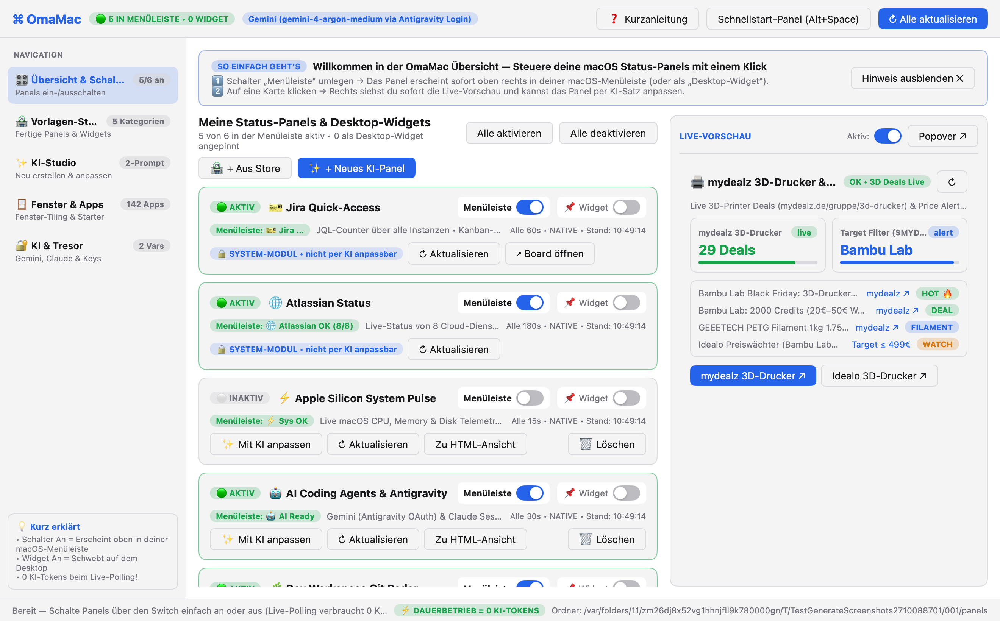

# omamac (OmaMac) — Omarchy & OmaLauncher for macOS (`mygo`)

Keyboard-first macOS Wal-Panel Launcher, Window Tiler & 2-Prompt Status Panel / Desktop Widget Studio built natively in Go with `github.com/egoist/mygo`.

## Key Features
- **Übersicht mit 1-Klick-Schaltern (`An / Aus`)**: Schalte Status-Panels in einer klaren Übersicht direkt per Switch für die **macOS-Menüleiste** oder als schwebendes **Desktop-Widget** ein und aus — inklusive sofortiger Live-Vorschau.
- **0-Token Live Polling**: KI (Gemini via Antigravity OAuth Login / API Key oder Claude) wird **nur** beim einmaligen Erstellen (Schritt 1) oder Anpassen (Schritt 2) genutzt. Im laufenden Betrieb führen die Panels lokal ihr Shell-/Python-Skript mit **0 KI-Tokens** aus.
- **Vorlagen-Store & Schnellstart (`Alt+Space`)**: Fertige Panels und Widgets in 5 Kategorien (System, Mac & Akku, Web/mydealz 3D-Drucker, Fokus-Timer, Pixel-Art Owl) direkt per Switch aktivierbar.
- **Zentraler Tresor (`macOS Keychain`)**: Zero-Leak `$ENV_VAR` Injektion in Panels über `mygo.Secrets`.
- **Jira Quick-Access (System-Modul)**: JQL-Counter über mehrere Jira-Instanzen, Liste, 3-Spalten-Board und Ticket-Viewer. Ersetzt die separate App `jira-quick-access` und übernimmt deren Instanzen automatisch aus `~/.jira-quick-access/config.json`.
- **Atlassian Status (System-Modul)**: Live-Status von 8 Atlassian-Cloud-Diensten inkl. aktiver Incidents.
- **Automatische Updates**: signierte Updates aus den GitHub-Releases (Menü „Nach Updates suchen…“).
- **`omamac -check <panel.json>`**: Prüft Abhängigkeiten, führt ein Live-Daten-Update aus und rendert eine Retina-PNG-Vorschau.



## Installation

```bash
brew install --cask diver80/tap/omamac
```

OmaMac aktualisiert sich danach selbst (signierte Updates aus den [GitHub-Releases](https://github.com/diver80/omamac/releases)).

## Entwicklung

```bash
go test ./...
go run ./cmd/omamac                                   # Entwicklungsstart (ohne Auto-Update)
go tool mygo build -platform darwin/universal         # OmaMac.app + DMG nach build/darwin-universal/
```

## Release

1. `version` in `mygo.json` erhöhen und einen Abschnitt `## <version>` in `CHANGELOG.md` anlegen (wird zu den Release-Notes im Update-Dialog).
2. Committen, dann `./scripts/release.sh`: testet, taggt, baut, lädt das Release nach `diver80/omamac` hoch, veröffentlicht es und aktualisiert den Cask in `diver80/homebrew-tap`.

Der geheime Update-Signaturschlüssel liegt unter `~/Library/Application Support/mygo/update-keys/mygo-update.key` (alternativ `MYGO_UPDATER_PRIVATE_KEY`). **Nicht ins Repo legen und sicher sichern** — ohne ihn können installierte Apps keine Updates mehr annehmen.
