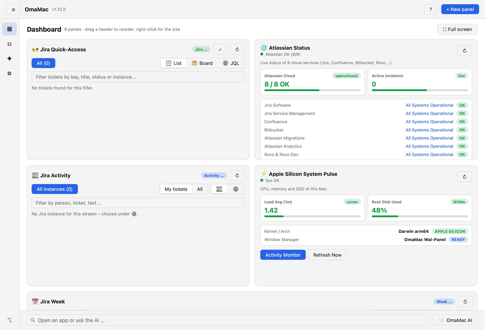
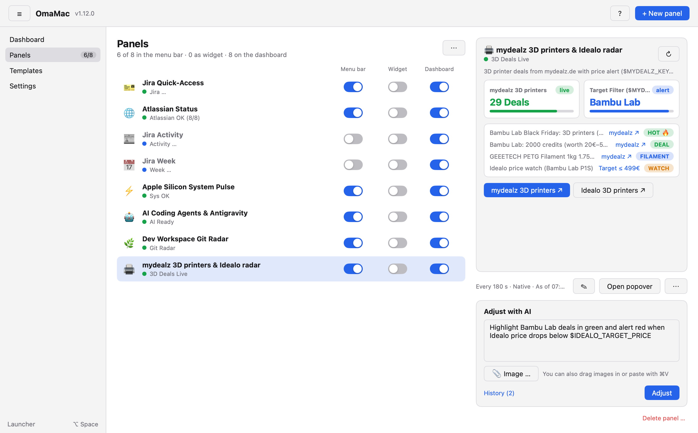
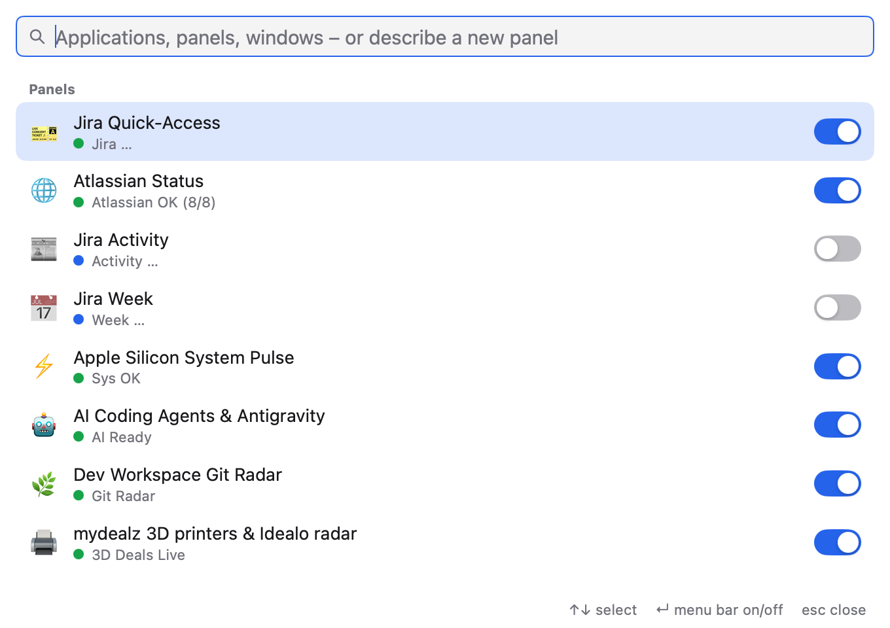

# OmaMac

Status panels for the macOS menu bar and desktop, built by an AI from a single sentence, plus a keyboard launcher for apps and windows – inspired by Omarchy, written natively in Go with [`mygo`](https://github.com/egoist/mygo).

The name is short for **Omarchy on the Mac**: [Omarchy](https://omarchy.org) is DHH's opinionated Arch Linux + Hyprland setup, whose keyboard-first launcher and status bar inspired OmaMac. OmaMac is an independent project, not affiliated with Omarchy, and brings that idea to macOS without replacing the macOS desktop.

The interface is available in English and German: it follows the macOS language, and Settings → General → Language switches it.

## Features

- **Dashboard:** The main window opens on all panels as tiles, with the launcher's bar below them, like a home screen. In full screen it is a Space of its own, a swipe away. Drag a tile's header to reorder, right-click for its size. The sidebar collapses to symbols (☰, ⌘\).
- **Panels for the menu bar, the desktop and the dashboard:** Every panel has three switches: "Menu bar" shows it in the top-right menu bar, "Widget" floats it on the desktop, "Dashboard" makes it a tile. The "Panels" view shows the selected panel's live preview, refresh interval and actions on the right.
- **Create and change panels with a sentence:** "+ New panel" describes a panel in one sentence; the AI (Gemini via Antigravity login or API key, or Claude) builds the panel and its data script. Changes work the same way, right next to the panel. Attach screenshots or mockups (button, drag & drop or ⌘V) and watch the AI's answer stream in while it works.
- **No AI at runtime:** Afterwards, panels refresh locally with their shell/Python script – no AI calls, no tokens.
- **Launcher (`⌥ Space`):** One search field for apps, panels and window layouts; driven with ↑↓ and ↵. As in [Omalauncher](https://github.com/SimonSchubert/omalauncher), a name opens what it names and a sentence goes to an agent:
  - OmaMac's own AI builds a panel in the dialog, with screenshots or mockups pasted with ⌘V;
  - a coding agent (Claude Code, Codex, Gemini CLI, Antigravity, opencode) works in the background in the panels folder, without a terminal, and shows its steps and answer in OmaMac. A reply continues its session; "Continue in the terminal" opens it interactively.
  ⇥ or the button next to the field switches between them. Optionally the launcher's bar floats on the desktop.
- **Coding agents write panels too:** Agents work in the panels folder, where `AGENTS.md` explains the panel format and lists the variables by name. In the background they may only edit files there and run `omamac` commands. `omamac check <panel>.json` runs a panel and renders a preview, with secret values shown as `$NAME`. OmaMac picks up new files at once, switched off. A command written outside OmaMac runs only after you allow it in the main window.
- **Share panels:** Export one or all of your panels as a `.omamac` file or via the clipboard, without live data or secrets – only the names of the variables they need. Import shows each panel's command first and adds panels switched off. A panel holding a secret in plain text cannot be exported.
- **Templates:** Add ready-made panels with a switch, or use one as the starting point for your own AI panel.
- **Vault (macOS Keychain):** Panels receive search terms and tokens as `$VARIABLE`; the AI only ever sees the name. The Jira Quick-Access instances add `$JIRA_<NAME>_URL`, `_EMAIL` and `_API_TOKEN` automatically.
- **Built-in modules:** Jira Quick-Access (JQL counters, board, ticket viewer; imports the instances from `~/.jira-quick-access/config.json`) and Atlassian Status.
  Two more work on the same Jira instances: **Jira Activity**, the activity stream of all sites like the Data Center gadget (your tickets or everything, optionally per project), and **Jira Week**, a Kanban board with a column per day that pages week by week, by last change, resolution or due date. Built-in modules keep their settings in the panel (which instances, JQL or projects per instance) and can be duplicated, e.g. one week board per customer; the Jira instances themselves are managed under Settings.
- **Log:** `~/Library/Logs/OmaMac/omamac.log` records failed panel scripts, AI calls, Jira errors and agent starts, with vault values and tokens masked. Each panel lists its last runs, and a failing script turns its panel red.
- **Automatic updates** from the GitHub releases.







## Installation

```bash
brew install --cask diver80/tap/omamac
```

OmaMac then keeps itself up to date (signed updates from the [GitHub releases](https://github.com/diver80/omamac/releases)).

## Development

```bash
go test ./...
OMAMAC_SCREENSHOTS=1 go test ./internal/omamac -run TestGenerateScreenshots   # refresh the screenshots in docs/
go run ./cmd/omamac                                   # development run (no auto-update)
go tool mygo build -platform darwin/universal         # OmaMac.app + DMG in build.noindex/darwin-universal/ (.noindex: kept out of Spotlight/Launchpad)
```

## Release

1. Bump `version` in `mygo.json` and add a `## <version>` section to `CHANGELOG.md` (it becomes the release notes in the update dialog).
2. Commit, then run `./scripts/release.sh`: it tests, tags, builds, uploads the release to `diver80/omamac`, publishes it and updates the cask in `diver80/homebrew-tap`.

The secret update signing key lives at `~/Library/Application Support/mygo/update-keys/mygo-update.key` (or `MYGO_UPDATER_PRIVATE_KEY`). **Never put it in the repo, and keep a safe backup** – without it, installed apps can no longer accept updates.
